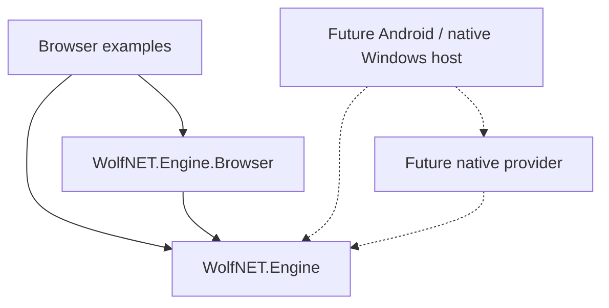

# Platform architecture and future support

WolfNET is intended to support different hosts, including Android and native
Windows. Only the browser provider is implemented today. There are no Android or
native Windows graphics, audio, windowing or input implementations yet.

## Dependency boundary



`WolfNET.Engine` is a plain `Microsoft.NET.Sdk` library targeting `net10.0`, with
no package dependencies or platform attributes. It owns simulation, worlds, map
compilation, physics, cameras, animation, input state, audio policy, UI layout,
controls, focus, hit testing and provider contracts. This logic must remain usable
by ordinary .NET programs, tests and tools without a browser or window.

`WolfNET.Engine.Browser` is a separate Razor class library referencing Engine.
It owns WebGPU, DOM events, pointer lock, animation-frame callbacks, Canvas text
measurement/drawing, native browser text editors/accessibility, Web Audio,
JavaScript and WGSL assets. Browser types live in `WolfNET.Engine.Browser.*`.

Applications compose providers and own game rules and assets. Provider startup
accepts the platform's canvas/window/surface and remains outside Engine. Engine
must never reference a provider project, Blazor, JavaScript interop, Android APIs,
Win32, a native graphics binding, or a specific UI framework. Do not add platform
conditionals or native handles to scene, physics or UI types.

## Provider contracts

| Area | Portable Engine API | Provider responsibility |
| --- | --- | --- |
| Frames | `IFrameLoop`, `FrameTiming` | Schedule callbacks on the host update thread, supply monotonic timing, stop stale callbacks and handle suspend/resume |
| World rendering | `ISceneRenderer`, `RenderFrame`, `RenderMap`, `SceneResources` | Initialize a platform surface, load/decode textures, prepare/release scene resources and draw frames |
| UI rendering | `IUiRenderer`, `UiFrame`, `UiDrawing` | Present ordered draw commands, transforms, clips, images and vectors at the host's pixel density |
| Fonts | `IUiTextMeasurer`, `UiFont` | Supply actual font metrics and loading; invalidate the document when metrics change |
| UI input | `UiDocument.Input` (`UiInputRouter`) | Translate pointer, wheel, keyboard, focus and edited text events; prevent handled UI input from reaching game input |
| Game input | `IKeyboardInput`, `IMouseInput`, `KeyboardState`, `InputBindings` | Translate device events into action state and relative look movement; reset state on capture/focus loss |
| Music | `IAudioBackend`, `IAudioStream`, `MusicPlayer` | Decode/stream clips, report playback state, apply gain, resume and dispose platform resources |
| Sound effects | `ISfxBackend<TCue>`, `ISfxVoice`, `SpatialSoundSystem<TCue>` | Play voices and apply gain/pan/pitch; preserve application-defined cue types and portable mixing policy |

World and UI renderers are independent. A future provider can implement both using
one native graphics API while consuming the existing portable data. Shader loading
and packed GPU buffers belong to that provider; `RenderMap`, sprites and UI nodes
are the shared input. Providers use public APIs, including sprite atlas frame,
width and geometry queries, rather than Engine internals or friend assemblies.

UI frames use logical coordinates. The host passes the viewport to `BuildFrame`;
pointer positions use the resulting frame's coordinate space. The provider maps
this to the actual surface and device pixel ratio. Font family names, CSS-style
color strings and image source strings are shared descriptive values: native
providers will need font fallback/color parsing and their own image resolution.
They must also supply platform text editing/IME and accessibility integration;
these services are not implemented by the portable UI model.

`IMouseInput` currently describes capture plus relative movement. A touch or
gamepad provider can translate its controls to those semantics, or an application
can provide a different actor/controller. It does not require hardware mouse input.
The current keyboard bindings use physical key codes; a provider maps its keys or
touch actions to those action names.

Map compilation accepts ordinary definitions and registries. Existing
`LoadAsync(HttpClient, ...)` methods are .NET HTTP convenience loaders, not a
requirement to host native assets over HTTP. A native host can deserialize bundled,
embedded or filesystem JSON and construct `TileMap` directly. Texture, font and
audio path resolution belongs to the provider/host, with game content remaining
outside Engine. Native asset loaders are future work.

## Adding Android or native Windows later

1. Create a provider project referencing Engine; put the platform SDK and native
   graphics/audio packages there. Use a separate application project for startup,
   window/activity lifetime, permissions and game composition.
2. Implement the required contracts above. Initialize native windows and graphics
   surfaces in the host. Keep scene updates and UI mutation on the same host
   update thread; marshal device callbacks onto it.
3. Connect suspend/resume, resize, DPI/orientation changes, text input, accessibility
   and device loss. Dispose provider resources and clear input on focus loss.
   Pause/resume policy remains application-owned; reset frame timing on resume.
4. Reuse the Engine consumer tests, add provider-specific integration tests, and
   verify actual device behavior. Browser rendering parity does not establish
   native rendering or platform support.

Do not add empty native providers or select a native UI/graphics framework until
that platform is being implemented. The current split establishes the dependency
boundary without making those future choices.

## Checking the boundary

`Tests/EngineConsumer` references Engine alone and runs native .NET assertions for
worlds, scenes, input, audio policy and retained UI. It verifies that the Engine
assembly does not depend on browser frameworks/providers or have a platform
restriction. Engine's project has no `PackageReference` or `FrameworkReference`.

```powershell
dotnet run --project Tests/EngineConsumer/WolfNET.EngineConsumer.csproj
dotnet list WolfNET.Engine/WolfNET.Engine.csproj package --include-transitive
dotnet pack WolfNET.Engine/WolfNET.Engine.csproj -o artifacts/packages
dotnet pack WolfNET.Engine.Browser/WolfNET.Engine.Browser.csproj -o artifacts/packages
```

Engine packages contain portable code and documentation. Browser packages contain
the browser code and assets and declare a dependency on Engine. Browser asset URLs
are `_content/WolfNET.Engine.Browser/`; native consumers do not receive those assets.

## Migrating an existing browser host

Add a reference to `WolfNET.Engine.Browser` and import its `.Graphics`, `.Input`,
`.Audio`, `.Core` or `.UI` namespaces where browser implementations are created.
Portable types retain their `WolfNET.Engine.*` namespaces. Update any manually
specified browser asset URLs from `_content/WolfNET.Engine/` to
`_content/WolfNET.Engine.Browser/`. The built-in provider loaders already use the
new paths. Scene, map and UI document composition remain the same.
